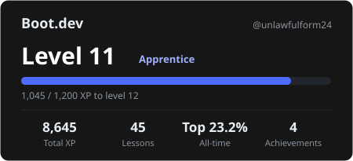
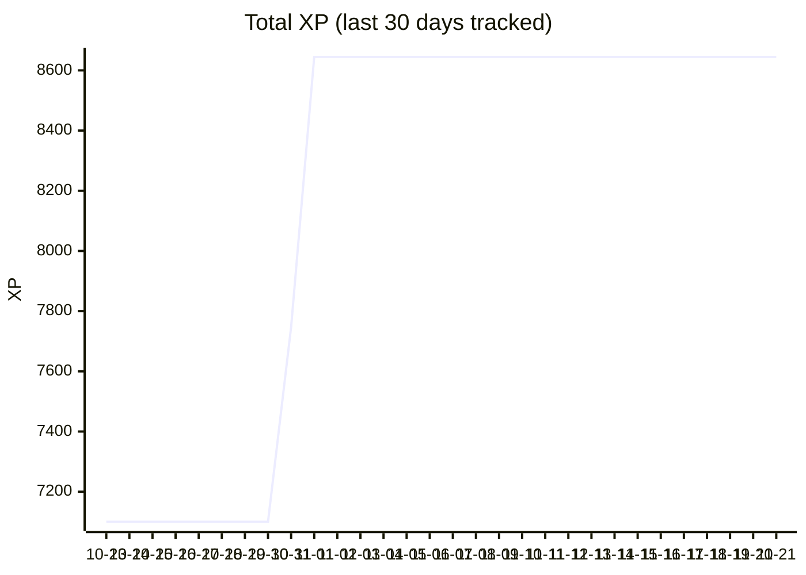

# 🐉 Boot.dev progress

My backend-development practice on [Boot.dev](https://www.boot.dev/u/unlawfulform24), tracked automatically.
A GitHub Action reads my public Boot.dev profile every day and updates this page, [`card.svg`](card.svg) and [`data/history.csv`](data/history.csv).

| Level | Rank | Total XP | Lessons completed | All-time leaderboard |
|:-:|:-:|:-:|:-:|:-:|
| **11** | Pupil | 8,645 | 45 | Top 23.3% |

## 📈 XP over time

## 🏆 Achievements unlocked

| | Achievement | Requirement | Unlocked |
|:-:|---|---|---|
|  | **Milestone: Bronze** | Complete 5 exercises | 2026-09-23 |
|  | **Milestone: Silver** | Complete 15 exercises | 2026-09-28 |
|  | **Sharpshooter: Bronze** | Complete 1 sharpshooter spree | 2026-09-28 |
|  | **Role: Pupil** | Reach level 10 | 2026-10-20 |

## 🗓️ Recent history

| Date | Level | XP | Lessons |
|---|:-:|--:|:-:|
| 2026-11-21 | 11 | 8,645 | 45 |
| 2026-11-20 | 11 | 8,645 | 45 |
| 2026-11-19 | 11 | 8,645 | 45 |
| 2026-11-18 | 11 | 8,645 | 45 |
| 2026-11-17 | 11 | 8,645 | 45 |
| 2026-11-16 | 11 | 8,645 | 45 |
| 2026-11-15 | 11 | 8,645 | 45 |
| 2026-11-14 | 11 | 8,645 | 45 |
| 2026-11-13 | 11 | 8,645 | 45 |
| 2026-11-12 | 11 | 8,645 | 45 |
| 2026-11-11 | 11 | 8,645 | 45 |
| 2026-11-10 | 11 | 8,645 | 45 |
| 2026-11-09 | 11 | 8,645 | 45 |
| 2026-11-08 | 11 | 8,645 | 45 |

## 💻 Solutions & projects

Code I write for Boot.dev courses and guided projects lives in [`solutions/`](solutions/), one folder per course.

Last updated 2026-11-21 05:36 IST · stats from the public Boot.dev API
