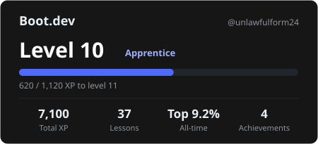

# 🐉 Boot.dev progress

My backend-development practice on [Boot.dev](https://www.boot.dev/u/unlawfulform24), tracked automatically.
A GitHub Action reads my public Boot.dev profile every day and updates this page, [`card.svg`](card.svg) and [`data/history.csv`](data/history.csv).

<p align="center"></p>

| Level | Rank | Total XP | Lessons completed | All-time leaderboard |
|:-:|:-:|:-:|:-:|:-:|
| **10** | Apprentice | 7,100 | 37 | Top 9.2% |

## 📈 XP over time

```mermaid
xychart-beta
    title "Total XP (last 7 days tracked)"
    x-axis ["10-21", "10-22", "10-23", "10-24", "10-25", "10-26", "10-27"]
    y-axis "XP"
    line [7100, 7100, 7100, 7100, 7100, 7100, 7100]
```

## 🏆 Achievements unlocked

| | Achievement | Requirement | Unlocked |
|:-:|---|---|---|
|  | **Milestone: Bronze** | Complete 5 exercises | 2026-09-23 |
|  | **Milestone: Silver** | Complete 15 exercises | 2026-09-28 |
|  | **Sharpshooter: Bronze** | Complete 1 sharpshooter spree | 2026-09-28 |
|  | **Role: Apprentice** | Reach level 10 | 2026-10-20 |

## 🗓️ Recent history

| Date | Level | XP | Lessons |
|---|:-:|--:|:-:|
| 2026-10-27 | 10 | 7,100 | 37 |
| 2026-10-26 | 10 | 7,100 | 36 |
| 2026-10-25 | 10 | 7,100 | 36 |
| 2026-10-24 | 10 | 7,100 | 36 |
| 2026-10-23 | 10 | 7,100 | 36 |
| 2026-10-22 | 10 | 7,100 | 36 |
| 2026-10-21 | 10 | 7,100 | 36 |

## 💻 Solutions & projects

Code I write for Boot.dev courses and guided projects lives in [`solutions/`](solutions/), one folder per course.

<sub>Last updated 2026-10-27 04:19 IST · stats from the public Boot.dev API</sub>
